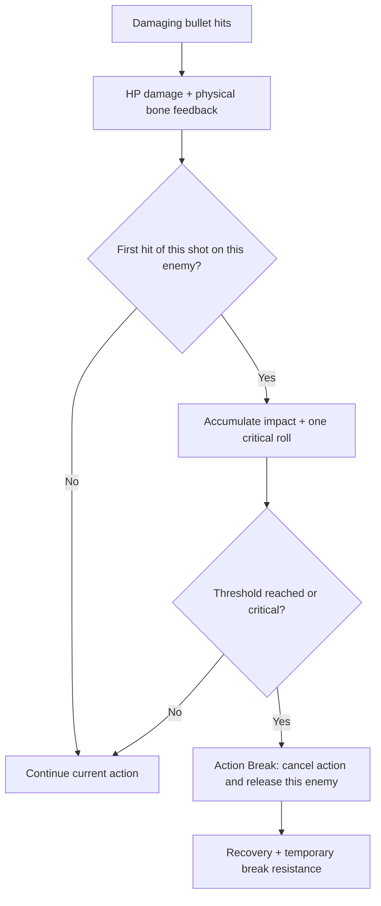

# Continuous pursuit and Action Break — 2026-10-18

## Behaviour

Escape no longer pauses the encounter, slows everyone to walking, blocks new attacks or resets all runner/pressure ownership when sprinting stops. Existing runner caps, staggered starts, Combat Turns, target detection/Search/Patrol and per-owner stalled/growing-gap handoff remain.

Ordinary damaging bullets still animate physical bone feedback and reduce HP. They no longer stop the NavMeshAgent, cancel attacks/Charge, apply root knockback or release movement/combat permissions automatically.

An actor-local impact meter causes Action Break when accumulated impact reaches its threshold or a shot rolls Critical Break. Break cancels the current action, applies the configured interruption/knockback and releases only that actor's places. Other enemies use the existing replacement/start intervals. Critical Break does not increase HP damage.

## Settings

Enemy Profile / Enemy Lab > Physics > **Action Break**:

| Field | Default | Meaning |
|---|---:|---|
| Enabled | On | Enable interruption decisions separately from visual feedback |
| Threshold | 60 | Guaranteed break at this accumulated impact |
| Impact Per Shot | 20 | Default contribution per shot per enemy |
| Head Multiplier | 1.5 | Increase head impact, independently of damage multipliers |
| Critical Chance | 0.05 | One early-break roll per shot per enemy |
| Recovery Delay | 1 s | Delay before unused impact recovers |
| Recovery Per Second | 10 | Impact recovered per second after that delay |
| Resistance After Break | 1.2 s | Extra immunity after the interruption/knockback duration |

**Action Break movement** retains Hit Stagger Duration / Hit Knockback Distance / Duration. They now apply only on Break. **Physical feedback (ordinary hits)** retains Enable Hit Reaction, impulse, physics duration, blend/recovery and bone angle support. It is independent of Action Break Enabled.

Guns > Weapon Stat > **Stagger Power** optionally overrides impact per shot. Zero uses the target profile's default. HP Damage remains separate.

Each trigger pull receives a shared shot ID. All shotgun pellets still deal their normal damage and physical feedback, but only the first hit of that volley on a given enemy contributes impact/rolls Critical. The first impact's hit location determines the head multiplier. Another enemy hit by the same volley has its own independent decision. IDs expire after the projectile lifetime. Calls without a shot ID remain independent impacts for compatibility.

Disarm remains a distinct exception: losing a weapon cancels the invalid weapon action and releases its combat turn, but does not automatically release pursuit ownership. Death retains its full ragdoll/cleanup path.

## Removed controls

Shared Combat's **Escape** tab is removed. Pause Rush While Escaping, Escape Resume Delay and Escape Slowdown Time are hidden legacy data and no longer control pursuit. The old EscapeWalk enum value remains to avoid renumbering serialized states, but is never entered. Adjust Pressure > per-owner handoff and Approach > runner limits instead.

## Verification

325 isolated Unity combat checks passed with production AI/NavMesh/effects and a player damage stub. Cases include continuous pursuit during sprint, no group reset when sprint ends, ordinary hits preserving an active attack and both permissions, threshold/critical breaks, resistance, impact recovery and volley deduplication. An additional 4523 weapon checks passed with production Bullet/HitBox damage and stubbed unrelated dependencies, including propagation of shot identity/impact power. Runtime/editor compilation passed. Actual gameplay balance and physical animation still need a scene playtest.
