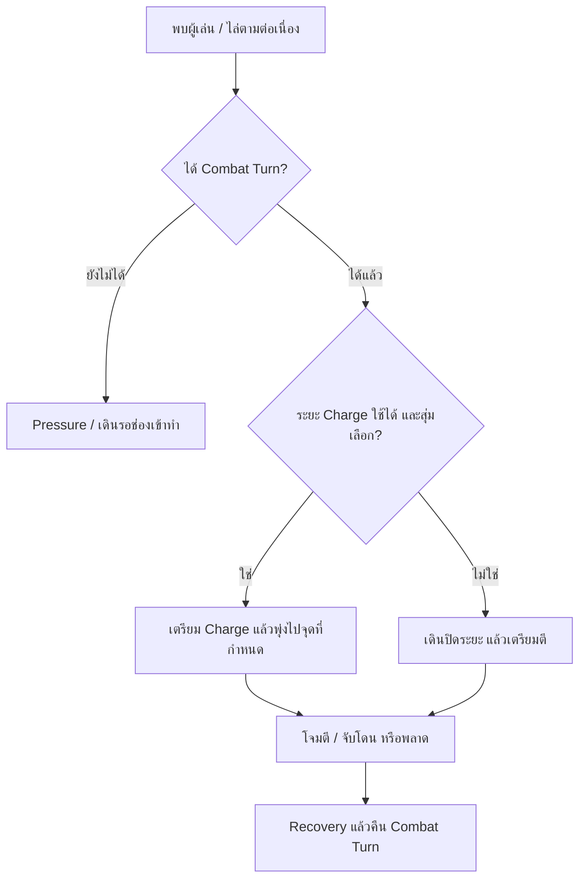

# Enemy combat: simplified flow

เอกสารนี้เป็นลำดับการทำงานปัจจุบันหลังแยกการเคลื่อนที่ออกจากสิทธิ์โจมตี (2026-10-17) รายละเอียดการแก้ก่อนหน้านี้ใน EnemyChargeGuide เป็นประวัติการปรับระบบ

## หน้าที่สองระดับ

**ระบบกลุ่ม (`EnemyAttackCoordinator`)** ให้ Combat Turn ตามจำนวนที่อนุญาต เว้นระยะเวลาระหว่างเริ่มโจมตี และบล็อกการโจมตีขณะผู้เล่นถูกจับ ไม่มีการสุ่ม Charge หรือเช็คสิทธิ์วิ่งในส่วนนี้

**ศัตรูแต่ละตัว (`EnemyController`)** เมื่อมี Combat Turn จึงเลือกว่าจะเดินเข้าประชิดหรือ Charge ตามระยะจริง โอกาส และ cooldown ของตัวเอง การไม่เลือก Charge ไม่ทำให้เสียสิทธิ์เข้าทำ

## การเคลื่อนที่และการหนี

- `EnemyRushCoordinator` ยังคุมจำนวนตัวที่วิ่ง การทยอยเข้าหา และระยะ Pressure แต่ไม่เป็นใบอนุญาตโจมตีอีกชั้น
- `P+` ใน gameplay หมายถึง Movement Slot; `A+` หมายถึง Combat Turn ซึ่งเป็นสิทธิ์ต่อสู้จริง
- ผู้เล่นวิ่งหนี: ไม่มีการผ่อนความเร็วหรือหยุดโจมตีทั้งฝูง วิ่งและโจมตีต่อภายใต้เพดานกลุ่มเดิม หากตัวใดตามไม่ทัน/ระยะห่างเพิ่มตามเกณฑ์ จึงคืนสิทธิ์เฉพาะตัวนั้น
- นัดทั่วไปมี Physical Reaction แต่ไม่คืนสิทธิ์ การขัดจังหวะเกิดเมื่อ Impact สะสมถึงเกณฑ์หรือ Critical Action Break เท่านั้น
- ท่าที่เริ่มไปแล้วทำต่อจนจบหรือเกิด Action Break การจับโดนบล็อกการเริ่มโจมตีของกลุ่มจนหมด hold/grace
- ผู้รอยังขอ Combat Turn จากขอบวง Pressure ได้ ไม่ต้องเข้าเขตตีหรือถือ Movement Slot ก่อน

## Charge

- ตรวจสิทธิ์ก่อนสุ่ม การอ่าน debug / ระยะขอสิทธิ์ / HasAttackTurn ไม่สุ่มและไม่เปลี่ยนการตัดสินใจ
- เลือกไม่ชาร์จ: เดินเข้าประชิด และรอ Decision Interval ก่อนลองเลือกใหม่ถ้ายังอยู่ในระยะที่ใช้ได้
- เลือกชาร์จ: คงตัวเลือกไว้ขณะรอ shared start interval ตรวจระยะจริงอีกครั้งหลังเตรียม แล้วพุ่งไปตำแหน่งที่บันทึกไว้
- หลุดระยะที่พุ่งถึงได้ / pause / เริ่ม Charge จะล้างตัวเลือกตามวงจรของมัน
- ความเร็ว เวลา อัตราเร่ง และระยะอาวุธจำกัดระยะเริ่ม Charge; ศัตรูยังพลาดได้เมื่อผู้เล่นหลบหลังเริ่มพุ่ง
- ไม่เกินหนึ่งตัวที่กำลังเตรียมหรือวิ่ง Charge ต่อผู้เล่นหนึ่งคน

## ช่องตั้งค่า

| ที่ตั้ง | หน้าที่ |
|---|---|
| Shared Combat: Attack Start Interval | เว้นเวลาเริ่มโจมตีระหว่างตัว |
| Enemy Profile: Group / Coordinate Attacks | เปิดการใช้ Combat Turn; ปิดคือโหมดโจมตีอิสระ |
| Enemy Profile: Group / Max Concurrent Attackers | จำนวน turn ของ encounter ตามกติกาเดิม เมื่อ profile ต่างกันใช้เพดานต่ำสุดของผู้ถือ turn |
| Enemy Profile: Movement | ความเร็วและการเข้าประชิด |
| Enemy Profile: Combat / Charge | โอกาส ระยะ ความเร็ว เวลา และแอนิเมชันของท่าชาร์จ |
| Shared Combat: Charge hold / grace / camera | เหตุการณ์จับโดนและช่วงคืนการควบคุม |

ซ่อน **Reserve For Mid Range**: เดิมใช้ลดโอกาส Charge ของตัวถือสิทธิ์ประชิด ตอนนี้เลิกใช้เพื่อไม่ให้บทบาทการเคลื่อนที่ซ้อนกับการเลือกโจมตี เก็บ serialized field ไว้รองรับ asset เดิม ช่อง tuning อื่นยังคงอยู่

## การตรวจสอบ

ผ่าน 312 checks ใน isolated Unity Play Mode โดยใช้ production AI, NavMesh, weapon modules และ player effects แต่ใช้ PlayerController damage stub รวมกรณี Movement Slot ไม่ให้สิทธิ์โจมตีเอง, รับ Combat Turn โดยไม่มี Movement Slot, เลือกไม่ Charge แล้วยังเข้าทำได้, การอ่าน debug ไม่สุ่ม และ Machete/Torch จาก saved profile เริ่ม Charge และเคลื่อนที่จริงได้ คอมไพล์ runtime/editor ผ่าน ส่วนจังหวะฝูงและกล้องในฉากหลักยังต้องยืนยันด้วย gameplay playtest

Current hit-response rules: [EnemyActionBreak.md](EnemyActionBreak.md). EscapeWalk enum and old serialized fields remain compatibility data only; no runtime transition enters that state.
